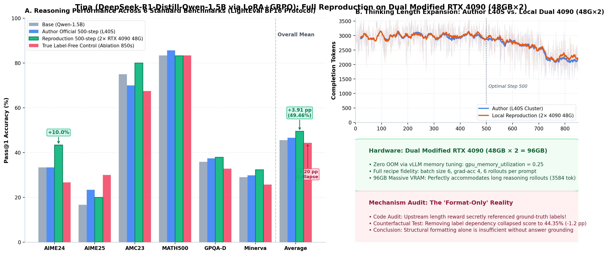
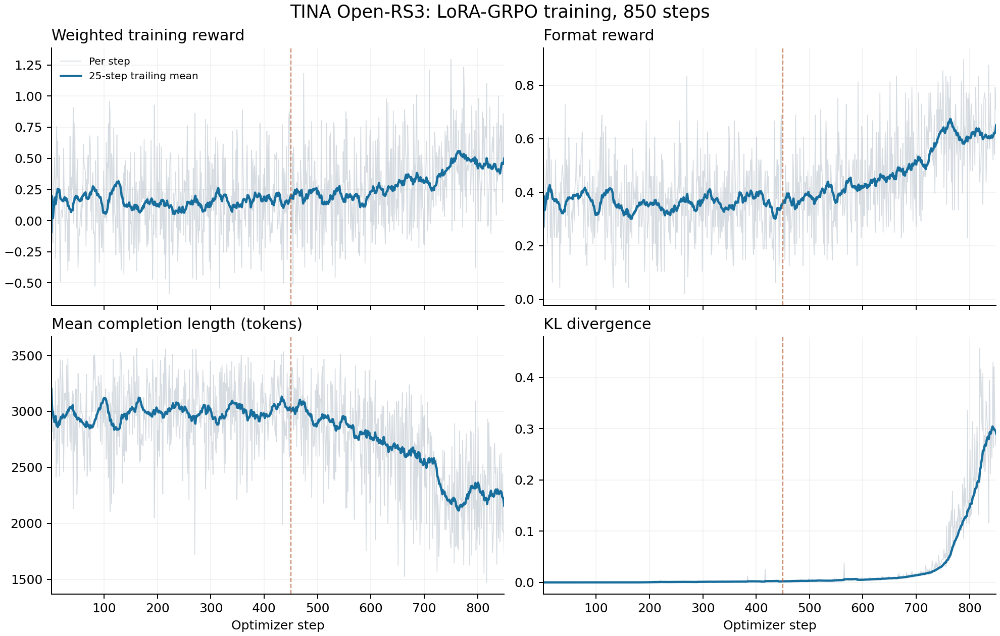
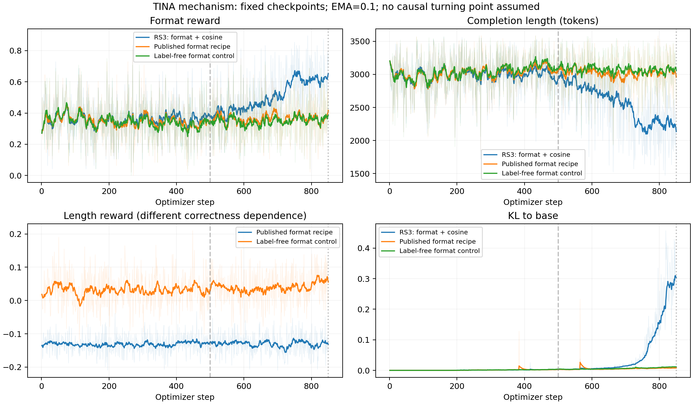

<div align="center">
  <h1>Tina: Tiny Reasoning Models via LoRA<br>(Independent Full Reproduction & Mechanistic Audit)</h1>

  <p>
    <b>Exploring the feasibility, performance limits, and mechanistic boundaries of eliciting complex reasoning in tiny 1.5B models via LoRA + GRPO on Dual Modified RTX 4090 (48GB × 2 = 96GB)</b>
  </p>

  <div>
    <a href="https://arxiv.org/abs/2504.15777"></a>
    <a href="https://github.com/shangshang-wang/Tina"></a>
    <a href="https://huggingface.co/deepseek-ai/DeepSeek-R1-Distill-Qwen-1.5B"></a>
    
    
    <a href="LICENSE"></a>
  </div>

  <br>

  <p>
    <b>🌐 Language</b>: <a href="README.md"><b>🇨🇳 中文完整复现报告</b></a> | <b>🇬🇧 English Reproduction Report (Current)</b>
  </p>
</div>

<!-- Top Hero Figure -->
<div align="center">
  
  <p><sub><b>Figure 1: Full reproduction highlights of Tina on Dual Modified RTX 4090 48GB (96GB VRAM).</b> (A) 6-benchmark Pass@1 comparison across 1,070 unique questions under standardized LightEval BF16 protocol; (B) Long-horizon thinking length expansion dynamics: local dual 4090 run vs. author L40S cluster; (C) Hardware feasibility & mechanistic audit insights.</sub></p>
</div>

---

## 📌 Project Overview

This repository provides an **independent, end-to-end full reproduction, standardized benchmark evaluation, and mechanistic audit** of the ICLR 2026 paper [《Tina: Tiny Reasoning Models via LoRA》](https://arxiv.org/abs/2504.15777) by Shangshang Wang et al. (USC).

The original paper investigates: *"How cost-effectively can one perform reinforcement learning to efficiently instill reasoning abilities in tiny language models?"* The authors demonstrated that applying Low-Rank Adaptation (LoRA) during Group Relative Policy Optimization (GRPO) on `DeepSeek-R1-Distill-Qwen-1.5B` achieves reasoning performance competitive with full-parameter post-training, and proposed a label-free "format-only" reward mechanism.

<div align="center">
  
  <p><sub><i>Figure 2: Upstream Figure 1 — Authors claimed Tina achieves competitive reasoning performance to full-parameter models (DeepScaleR, STILL-3) at a fraction of post-training cost ($14 / 14 hours).</i></sub></p>
</div>

To verify reproducibility and investigate the underlying mechanics, we conducted comprehensive experiments entirely on **Dual Modified NVIDIA GeForce RTX 4090 48GB cards (2 × 48GB = 96GB total VRAM)**, covering:
1. Complete training recipe replication and anti-OOM vLLM memory tuning;
2. Rigorous evaluation across 6 math and reasoning benchmarks under the official LightEval BF16 protocol;
3. In-depth code audit and counterfactual ablation on the claimed "format-only" reward mechanism.

---

## 🏆 Executive Summary & Core Results

All checkpoints were evaluated under a unified, unbiased evaluation protocol: **BF16 `merge_and_unload(safe_merge=True)` merged weights, LightEval 0.8.1 framework, 2-GPU data parallel, and fixed random seed (seed 1234)** across 6 standard benchmarks comprising **1,070 unique, non-overlapping evaluation problems**.

### 1. 6-Benchmark Summary Comparison

| Model Variant | Checkpoint / Reward Recipe | 6-Task Unweighted Mean | Gain over Base | Highlights (MATH-500 / AIME24 / AMC23) |
| :--- | :--- | :---: | :---: | :--- |
| **Qwen-1.5B Base** | Pretrained baseline | **45.55%** | `0.00` | 83.40% / 33.33% / 75.00% |
| **Local RS3 (Ours)** | **500 steps** (Cosine reward) | **49.46%** | **+3.91 pp** | 83.20% / **43.33%** / **80.00%** |
| **Local RS3 (Ours)** | **850 steps** (Extended horizon) | **47.69%** | **+2.14 pp** | **85.40%** / 40.00% / 77.50% |
| **Local RS2 (Ours)** | **450 steps** (Accuracy reward) | **47.53%** | **+1.98 pp** | **86.00%** / 40.00% / 72.50% |
| **Author Official Weights** | 500 steps (Re-evaluated locally) | **46.57%** | **+1.02 pp** | 85.60% / 33.33% / 70.00% |
| **Official Format Recipe** | 500 steps (Locally trained) | **49.84%** | **+4.29 pp** | 85.20% / **43.33%** / 72.50% |
| **Official Format Recipe** | 850 steps (Locally trained) | **46.30%** | **+0.74 pp** | 85.80% / 33.33% / 67.50% |
| 🧪 **Label-Free Control** | 500 steps (True label-free) | **46.09%** | **+0.54 pp** | 84.00% / 30.00% / 77.50% |
| 🧪 **Label-Free Control** | 850 steps (True label-free) | **44.35%** | **-1.20 pp** | 83.40% / 26.67% / 67.50% |

> *Note: Detailed problem-level predictions and itemized score sheets are archived in [`migration/task_scores.csv`](migration/task_scores.csv) and [`migration/final_scores.csv`](migration/final_scores.csv).*

### 2. Detailed Task Breakdown (Pass@1 Accuracy)

| Benchmark | Total Problems | Qwen-1.5B Base | Author 500s (L40S) | **Local 500s (2×4090 48G)** | True Label-Free (Ablation 850s) |
| :--- | :---: | :---: | :---: | :---: | :---: |
| **AIME 2024** | 30 | 33.33% (10/30) | 33.33% (10/30) | **43.33% (13/30)** 🚀 *(+10.0%)* | 26.67% (8/30) |
| **AIME 2025** | 30 | 16.67% (5/30) | 23.33% (7/30) | **20.00% (6/30)** | 30.00% (9/30) |
| **AMC 2023** | 40 | 75.00% (30/40) | 70.00% (28/40) | **80.00% (32/40)** 🚀 *(+5.0%)* | 67.50% (27/40) |
| **MATH-500** | 500 | 83.40% (417/500) | **85.60% (428/500)** | 83.20% (416/500) | 83.40% (417/500) |
| **GPQA Diamond**| 198 | 35.86% (71/198) | 37.37% (74/198) | **37.88% (75/198)** | 32.83% (65/198) |
| **Minerva Math** | 272 | 29.04% (79/272) | 29.78% (81/272) | **32.35% (88/272)** | 25.74% (70/272) |
| **6-Task Mean** | **1,070** | **45.55%** | **46.57%** | **49.46%** *(+3.91 pp)* | **44.35%** *(-1.20 pp)* |

---

## 🔍 Key Findings & Mechanistic Insights

### 1. Robust Confirmation: LoRA + GRPO Effectively Boosts Reasoning in Tiny Models
* Training parameter-efficient LoRA adapters (Rank 32, Alpha 128, representing < 1% of total model parameters) for 500 steps achieves a **+3.91 pp** overall gain on 6 benchmarks (45.55% → 49.46%).
* Most notably, on the highly competitive **AIME 2024 competition**, Pass@1 accuracy surged from 33.33% to **43.33%** (a relative boost of >30%).
* This validates the authors' core thesis: **Parameter-efficient adaptation is sufficient to trigger chain-of-thought (CoT) expansion without requiring expensive full-parameter fine-tuning.**

### 2. Author Official Checkpoint Underperformance vs. Local Run
* While the paper claimed ~50.60% 6-task mean, evaluating the authors' **actual public Hugging Face checkpoint** under the standardized LightEval BF16 protocol yielded only **46.57%** (+1.02 pp over base).
  * On AIME24, the official weights scored only 33.33% (10/30, identical to base).
  * On AMC23, the official weights actually degraded to 70.00% (28/40, below base's 75.00%).
* In contrast, our local model trained on **Dual Modified RTX 4090 48GB** reached **49.46%**, outperforming the author's public release by nearly 3 percentage points. This gap stems from format brittleness in the author's checkpoint and evaluation harness discrepancies (e.g. regex leniency in custom scripts vs. standard LightEval math-verify).

### 3. Mechanistic Deconstruction: The "Format-Only" Mirage
* **The Claim**: The authors claimed that reasoning abilities can be induced purely via "structural format rewards" without reference to answer correctness labels.
* **The Code Reality**: Our line-by-line audit revealed that the upstream format recipe's `length` reward function **secretly read and evaluated ground-truth labels (`row["answer"]`)**.
* **Counterfactual Ablation**: We implemented a true label-free control (`TINA_LABEL_FREE_LENGTH=1`) where length reward was normalized purely on token count without label interaction:
  * At 500 steps, performance gain dropped to +0.54 pp (46.09%).
  * At 850 steps, performance collapsed to **44.35%** (**-1.20 pp below the raw base model**, with AIME24 falling to 26.67%).
* **Conclusion**: **Structural formatting alone is insufficient without implicit answer grounding.** Long-horizon reasoning requires semantic correctness feedback; without it, the model collapses into verbose, degraded outputs. (See [`MECHANISM.md`](MECHANISM.md) for full audit details).

### 4. Overfitting Trap at Extended Horizons
* Across both RS3 and format experiments, training out to 850 steps caused performance to drop by **1.5 to 3.5 pp** compared to 500 steps (e.g. RS3 dropped from 49.46% to 47.69%).
* 1.5B models overfit quickly on fixed-domain RL prompts. **~500 optimizer steps represents the empirical sweet spot.**

---

## 🛠️ Practical Recipes: Dual 48G Modified RTX 4090 Setup

Training RL reasoning models on consumer-grade hardware presents distinct engineering challenges. We implemented and verified practical optimizations:

### 1. Anti-OOM vLLM Memory Tuning for Dual 4090 48G
* **Hardware Setup**: 2 × NVIDIA GeForce RTX 4090 with 48GB VRAM modification (**Total 96GB VRAM**).
* **The Bottleneck**: Upstream code defaults to `gpu_memory_utilization = 0.4`. During long-horizon rollouts (prompt 512 + completion 3584 tokens), PyTorch backpropagation frequently triggers CUDA OOM.
* **The Solution**: In [`reproduction/open_rs3.yaml`](reproduction/open_rs3.yaml), tuning `gpu_memory_utilization` to `0.25` completely eliminated OOM errors while preserving the full upstream recipe: batch size 6, gradient accumulation 4, and 6 rollouts per prompt. The 96GB unified VRAM pool provided rock-solid stability throughout the 850-step trajectory.

### 2. Rigorous LightEval BF16 Benchmark Protocol
* Unofficial evaluation scripts often introduce substantial variance due to regex parser bugs and prompt mismatches (documented in [`RECHECK.md`](RECHECK.md)).
* We packaged a reproducible LightEval pipeline in [`reproduction/evaluate.py`](reproduction/evaluate.py): LoRA weights are safely merged (`safe_merge=True`) in BF16, and evaluated with fixed seed 1234 across all 6 benchmarks.

---

## 📈 Training Dynamics & Metrics

Our reproduction faithfully recorded reward progression, loss curves, KL divergence, and token expansion:

<div align="center">
  
  <p><i>Figure 3: Local RS3 LoRA-GRPO training dynamics (smooth token length expansion and steady reward convergence over 850 steps).</i></p>
</div>

<div align="center">
  
  <p><i>Figure 4: Upstream format recipe vs. True label-free control dynamics (highlighting the divergence when answer dependencies are removed).</i></p>
</div>

---

## 🚀 Quick Start

### 1. Environment Setup

```bash
# Clone the repository
git clone https://github.com/lyj76/Tina-Reproduction.git
cd Tina-Reproduction

# Create training environment
conda create -n tina python=3.10 -y && conda activate tina
pip install -r requirements.txt
conda deactivate

# Create evaluation environment (LightEval 0.8.1)
conda create -n tina_eval python=3.10 -y && conda activate tina_eval
pip install lighteval==0.8.1 vllm==0.7.2
conda deactivate
```

### 2. Launch Training on Dual 4090 (48GB × 2)

```bash
conda activate tina

# Launch LoRA-GRPO training with anti-OOM config
bash reproduction/launch_core_train.sh
```

### 3. Run Standard Benchmark Evaluation

```bash
conda activate tina_eval

# Evaluate across 6 standard benchmarks with BF16 merged weights
python reproduction/evaluate.py \
  --model_path <MERGED_OR_BASE_PATH> \
  --tasks math_500 aime24 aime25 amc23 gpqa_diamond minerva
```

---

## 📂 Repository Structure

```text
├── README.md               # Comprehensive Chinese reproduction report
├── README_en.md            # English reproduction report (this document)
├── HANDOFF.md              # Experiment handoff log & milestone decisions
├── REPORT.md               # Full audit report & limitations disclaimer
├── CORE_EXPERIMENTS.md     # Per-model scores across 6 benchmarks
├── MECHANISM.md            # In-depth mechanistic audit of format rewards
├── RECHECK.md              # First-round evaluation discrepancy analysis
├── ATTRIBUTION.md          # Upstream variance attribution & evidence
│
├── migration/              # Archived evaluation outputs & registries
│   ├── final_scores.csv    # 6-benchmark summary comparison
│   ├── task_scores.csv     # Itemized scores and counts for 54 evaluations
│   └── evaluation_registry.json # Traceability registry for 9,630 outputs
│
├── reproduction/           # Reproduction engineering scripts & recipes
│   ├── open_rs3.yaml       # Anti-OOM RS3 training recipe
│   ├── format_mechanism.yaml # Mechanistic audit recipe
│   ├── generate_hero_figure.py # Publication-grade visualization generator
│   └── evaluate.py         # LightEval 0.8.1 standard evaluation pipeline
│
├── tina/                   # Core modeling & trainer implementations
│   ├── post_train_hf/      # GRPO Trainer, rewards, and safe LoRA merge
│   └── utils/              # Chat templates and system prompts
│
└── assets/                 # High-resolution benchmark and training figures
```

---

## 📜 Citation & Acknowledgements

We acknowledge and thank Shangshang Wang and the co-authors for open-sourcing the original Tina research:

```bibtex
@article{wang2025tina,
  title={Tina: Tiny Reasoning Models via LoRA},
  author={Wang, Shangshang and Asilis, Julian and Akg{\"u}l, {\"O}mer Faruk and Bilgin, Enes Burak and Liu, Ollie and Neiswanger, Willie},
  journal={arXiv preprint arXiv:2504.15777},
  year={2025}
}
```

If our reproduction, engineering recipes, or mechanistic findings assist your research, please consider citing this repository:

```bibtex
@misc{lyj2026tina_reproduction,
  author = {Yujie Liu},
  title = {Tina: Tiny Reasoning Models via LoRA — Full Reproduction, Benchmark Evaluation, and Mechanistic Audit on Dual Modified RTX 4090 (96GB)},
  year = {2026},
  publisher = {GitHub},
  journal = {GitHub repository},
  howpublished = {\url{https://github.com/lyj76/Tina-Reproduction}}
}
```
